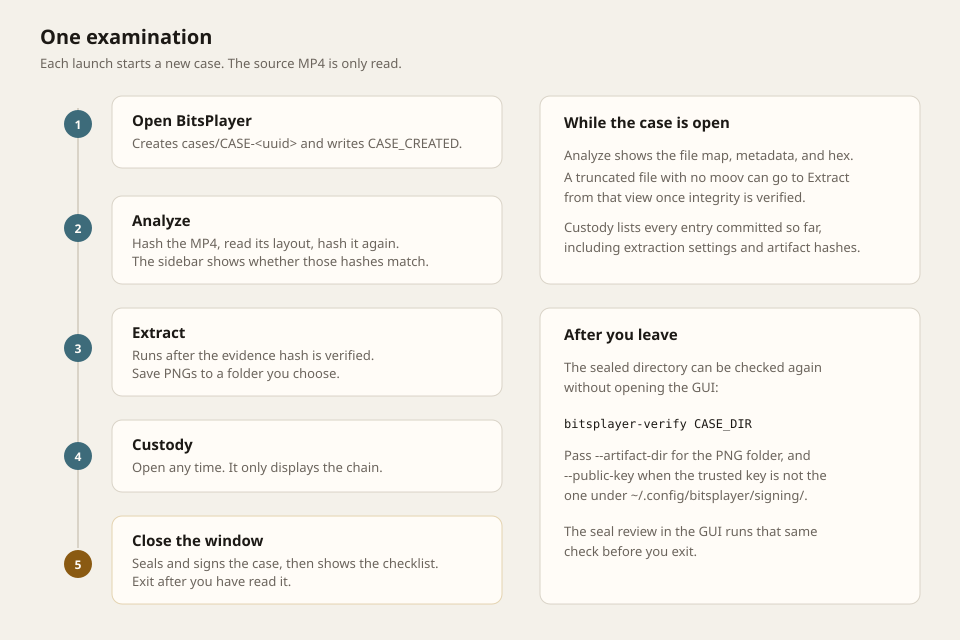
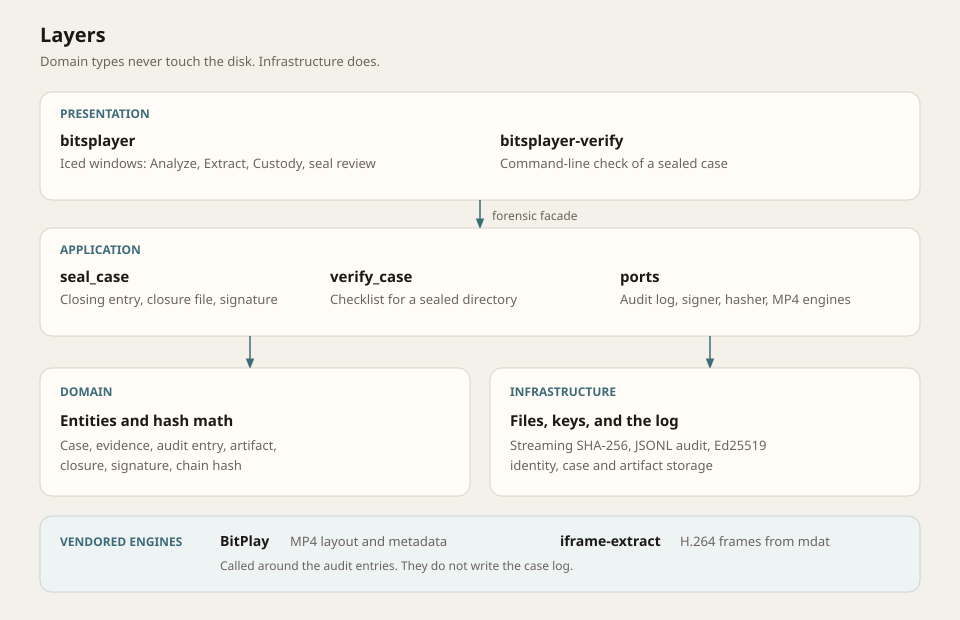
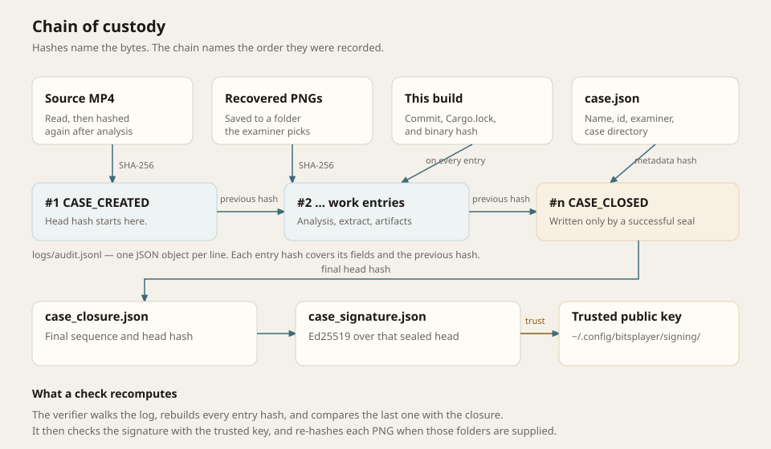

# BitsPlayer

BitsPlayer examines an MP4, recovers frames from a truncated H.264 file, and keeps a hash-chained record of that work. The desktop app is for the examination. `bitsplayer-verify` checks the sealed record afterwards.

The source file is only read. Before analysis it is copied into the case as a read-only working copy, and analysis and extraction read that copy. Case files, the audit log, and recovered images are written elsewhere.

## Examine a file



1. **Open the app.** `cargo run` starts a new case under `cases/CASE-<uuid>/`. The case name is `BitsPlayer Session`. The examiner name is the `BITSPLAYER_EXAMINER` environment variable when that variable is set.

2. **Analyze.** Choose an MP4. BitsPlayer copies it to `evidence/working-<uuid>.mp4` inside the case, checks the copy against the source hash, and makes it read-only. If the copy fails, the failure is logged and analysis does not start. BitsPlayer then hashes the working copy, reads the box layout, metadata, and frame map, then hashes it again. The sidebar reports whether the two hashes match. A matching pair is recorded as a verified integrity check. A mismatch stops the examination with a critical integrity failure.

3. **Extract, after that check has succeeded.** Set the width, height, and colour matrix, then recover frames. Saving writes PNGs into a folder you choose and records a SHA-256 for each new file. If a file with that name is already there, the save stops and leaves it untouched. Frame names include the byte offset they were carved from.

   When the file has no `moov` atom, Analyze offers **Open Extract** once integrity is verified. The Extract tab stays blocked until that verification is on the audit log.

4. **Custody.** Open this tab at any point before you close the window. It shows the case id, examiner, directory, host, and build, then one row for every audit entry committed so far. Opening the tab does not add an entry.

5. **Close the window.** The app writes `report.json`, `report.html`, and `report_manifest.json`, appends `CASE_CLOSED`, writes `case_closure.json` and `case_signature.json`, and runs the same checks as `bitsplayer-verify`. The checklist stays on screen. **Exit**, or close the window again, leaves the application. If sealing fails, the window stays open and the error is shown.

The first seal on a machine creates an Ed25519 key under `~/.config/bitsplayer/signing/`. The review says so. Later seals reuse that key. The signature is meaningful once you trust `public.key` from that directory.

## Check a sealed case

From a copy of the case directory, and the PNG folder if the case recorded artifacts:

```bash
cargo run --bin bitsplayer-verify -- path/to/CASE-<uuid>
cargo run --bin bitsplayer-verify -- path/to/CASE-<uuid> \
  --artifact-dir path/to/pngs \
  --public-key path/to/public.key
```

Exit status `0` means the checklist passed. Status `1` means the case did not verify. Status `2` means the arguments were rejected.

With no `--public-key`, the command trusts `~/.config/bitsplayer/signing/public.key`. A case that recorded recovered frames must be given the directory those files are in. One `--artifact-dir` covers one folder. The in-app seal review passes every folder that session actually logged.

## Export a sealed case

```bash
cargo run --bin bitsplayer-export -- path/to/CASE-<uuid>
cargo run --bin bitsplayer-export-verify -- path/to/CASE-<uuid>-export.zip
```

`bitsplayer-export` writes `CASE-<uuid>-export.zip` next to the case directory, with the case files, the report, the audit log, and the working copies. It also writes `CASE-<uuid>-export.zip.sha256`. Only a sealed case can be exported, and an existing export is never overwritten.

`bitsplayer-export-verify` checks the ZIP against that `.sha256` file, checks that the required files are present, and checks the report files against `report_manifest.json`. It does not verify the audit chain. Extract the ZIP and run `bitsplayer-verify` on the directory for that.

`bitsplayer-report path/to/CASE-<uuid>` writes `report.json` and `report.html` for a case that does not have them yet.

## How the program is put together



| Layer | Role |
| --- | --- |
| `src/presentation/` | The iced windows and the verify, report, and export commands. |
| `src/forensic/` | Facade those two entry points call. |
| `src/application/` | Evidence copying, sealing, the report, export, and `verify_case`, plus the ports they depend on. |
| `src/domain/` | Case, evidence, audit entries, artifacts, closure, signature, and the hash-chain math. No filesystem. |
| `src/infrastructure/` | Streaming SHA-256, the working copy, the JSONL log, case and report files, export ZIPs, and the Ed25519 key. |
| `vendor/video-analyzer` | BitPlay. MP4 layout, metadata, and the file map. |
| `vendor/iframe-extract` | Frame recovery by carving H.264 out of `mdat`, including when `moov` is gone. |

Analyze and Extract call those engines and write an audit entry around the call. The engines do not update the case log.

Build provenance is fixed at compile time. The build reads `git rev-parse HEAD` and the SHA-256 of `Cargo.lock`, and refuses to finish if either is missing. At startup the running binary is hashed as well. Every audit entry stores the tool version, commit, lock hash, and binary hash. A sealed case whose entries disagree about that build is rejected.

## What the case directory holds



```text
cases/CASE-<uuid>/
├── case.json
├── case_closure.json      after a successful seal
├── case_signature.json    after a successful seal
├── report.json            after a successful seal
├── report.html            after a successful seal
├── report_manifest.json   after a successful seal
├── evidence/
│   └── working-<uuid>.mp4 read-only working copy
└── logs/
    └── audit.jsonl
```

`audit.jsonl` is one JSON object per line. Each line has a sequence number, a timestamp, an action, and `entry_hash`. The hash covers the entry's fields and `previous_entry_hash`, so editing or reordering a line breaks the chain. The log is exclusively locked while the app has the case open.

Actions you will see:

| Action | When |
| --- | --- |
| `CASE_CREATED` | The case directory is created. |
| `EVIDENCE_COPY_STARTED` / `EVIDENCE_COPY_COMPLETED` / `EVIDENCE_COPY_FAILED` | Around the working copy. The completed row records the source and copy paths and hashes. |
| `EVIDENCE_REGISTERED` | The working copy is registered for analysis. |
| `ANALYSIS_STARTED` / `ANALYSIS_COMPLETED` / `ANALYSIS_FAILED` | Around the layout pass. |
| `INTEGRITY_VERIFICATION` | The before/after evidence hashes have been compared. |
| `CARVE_ANALYSIS_STARTED` / `CARVE_ANALYSIS_COMPLETED` / `CARVE_ANALYSIS_FAILED` | Around the H.264 carve of `mdat`, after integrity is verified. These rows include width, height, and the audio flag. |
| `EXTRACT_STARTED` / `EXTRACT_COMPLETED` / `EXTRACT_FAILED` | Around frame recovery. These rows include width, height, matrix, and the include flags, plus `frame_offset` for single-frame extraction. Once a case has carve rows, each extract must follow a completed carve with the same width and height. |
| `ARTIFACT_CREATED` | A PNG was written and hashed. The row links it to the source evidence hash. |
| `CASE_CLOSED` | The seal succeeded. This is the last row. |

`case_closure.json` stores that last sequence number and head hash. `report_manifest.json` holds the SHA-256 of `report.json` and `report.html`, and its own hash is stored in the closure. `case_signature.json` is an Ed25519 signature over the case id, that head, the `case.json` hash, and the report manifest hash. Verification loads your trusted public key and requires the key embedded in the signature file to be the same key. A key carried inside the case is not treated as the trust anchor.

The verifier then re-reads `case.json`, walks the log, checks host and examiner fields stay constant, checks operation details on the analysis and extraction rows, checks that every analysis follows a completed copy and re-hashes the working copies, checks the report files against the manifest, and re-hashes artifact files when their folders are supplied.

Recovered PNGs stay in the folder you picked. They are not copied into the case directory.

## Build and run

The build needs a git checkout and `Cargo.lock`, because both are part of the provenance stamped into the binary.

```bash
cargo run
cargo run --bin bitsplayer-verify -- --help
cargo run --bin bitsplayer-export -- --help
```

Development history and the integrity rules in more detail are in [docs/BitsPlayer_Forensic_Progress.md](docs/BitsPlayer_Forensic_Progress.md).

The GUI starts a new case on every launch. It has no field for the case name, and no command for opening a case that was sealed earlier. Use `bitsplayer-verify` for that check.
